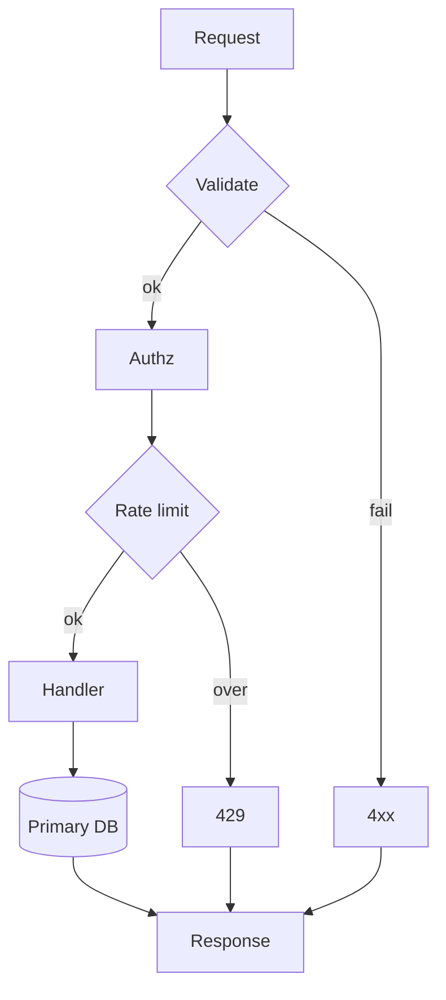

<!-- translated from upstream/references/blocks/explain.md @ e233797 — see docs/TRANSLATION.md -->
# EXPLAIN blocks — explaining how it works

Blocks for the explainer genre and any research where you need to explain how X works.

---

## E1 — `mental-model`

**When:** Explainer always. Technical topics.

**What's inside:** An ASCII diagram of the structure + 3-5 key entities with short definitions.

**Anti-pattern:** A detailed UML/architecture diagram. A mental model is a simplification, not a full specification.

**Composition:** After `tldr`, before `stepwise`. If there is a `glossary-mini` — after it (the reader first sees the terms, then the diagram).

**Template:**

```markdown
## Mental model

How it works in one sentence: <X consists of A, B, C; A and B talk through D>.

```
                   ┌─────────┐
                   │  USER   │
                   └────┬────┘
                        │ HTTP
                        ▼
            ┌───────────────────┐
            │   API Gateway     │
            └─────┬─────────┬───┘
                  │         │
            ┌─────▼─┐   ┌──▼────┐
            │ Auth  │   │ Data  │
            │ svc   │   │ svc   │
            └───────┘   └───┬───┘
                            │
                       ┌────▼────┐
                       │ Postgres│
                       └─────────┘
```

**Key entities:**
- **USER** — the consumer of the API
- **API Gateway** — the single entry point, routing + rate limit
- **Auth service** — issues/validates JWT
- **Data service** — business logic and database work
- **Postgres** — the single store of state
```

---

## E2 — `glossary-mini`

**When:** Explainer always. Any report with specific vocabulary.

**What's inside:** 5-10 terms with a one-phrase definition.

**Anti-pattern:** Expanding definitions into paragraphs — that is what `glossary-full` is for. Duplicating well-known terms.

**Composition:** Before `mental-model` (the reader knows the terms before the diagram). Excludes `glossary-full` and `glossary-link`.

**Template:**

```markdown
## Glossary (mini)

- **<Term 1>** — <definition in one phrase>
- **<Term 2>** — <definition>
- **<Term 3>** — <definition>
- **<Term 4>** — <definition>
- **<Term 5>** — <definition>
```

---

## E3 — `glossary-full`

**When:** Custom for topics with complex terminology where the definitions require context.

**What's inside:** Extended definitions with examples and links between the terms.

**Anti-pattern:** Using it instead of `glossary-mini` when a short one is enough. It is for deliberately term-heavy research.

**Composition:** Excludes `glossary-mini`. After `mental-model` (the diagram provides the context).

**Template:**

```markdown
## Glossary (full)

### <Term 1>

**Definition:** <2-3 sentences>

**Example:** <a concrete example of use>

**Not to be confused with:** <a similar term> — the difference is that <…>

**Related to:** [<Term 2>](#term-2), [<Term 5>](#term-5)

---

### <Term 2>

...
```

---

## E4 — `stepwise`

**When:** Explainer for sequential processes. Any mechanism that unfolds over time.

**What's inside:** Numbered steps of how the mechanism works.

**Anti-pattern:** Overly general steps («first the request, then the response»). Every step must have substance.

**Composition:** After `mental-model`. Before `variants` or `worked-example`.

**Template:**

```markdown
## How it works (step by step)

1. **<Step 1>** — <what happens, who initiates, which data is passed> [s03]

2. **<Step 2>** — <…> [s07]
   - Substep A: <detail>
   - Substep B: <detail>

3. **<Step 3>** — <…> [s07]

4. **<Step 4>** — <…> [s12]

5. **<Step 5>** — <completion>

**Latency of this path:** <if applicable>
**Bottleneck:** <where it usually stalls, if applicable>
```

---

## E5 — `variants`

**When:** Explainer when X has several implementations or variants.

**What's inside:** A table of variants with where they occur and how they differ.

**Anti-pattern:** Including rare/historical variants without separating them from the mainstream. Make it explicit: "common" vs "rare/historical".

**Composition:** After `stepwise`. Before `failure-modes` if there is one.

**Template:**

```markdown
## Implementation variants

### Common variants

| Variant | Where it occurs | How it differs | Source |
|---|---|---|---|
| A (canonical) | <products> | the base implementation | [s01] |
| B | <product X> | + optimization Y | [s05] |
| C | <product Z> | uses D instead of A | [s09] |

### Rare / historical

| Variant | Where | Why it matters now |
|---|---|---|
| Legacy X | old systems | still in N% of products |
```

---

## E6 — `worked-example`

**When:** Explainer for education-style research. When theory does not stick without an example.

**What's inside:** A real scenario walking through all the steps.

**Anti-pattern:** An overly abstract example («foo bar baz»). Take a real system/case.

**Composition:** After `stepwise` or `variants`. Makes the abstraction concrete.

**Template:**

```markdown
## Worked example

**Scenario:** <a concrete real case>

**Step 1:** <what happens in this example>
- Input: <concrete data>
- What the system does: <concrete action>
- Output: <concrete result>

**Step 2:** ...

**Step 3:** ...

**Result:** <final outcome + what is important to notice>

**What the example teaches:** <the main takeaway> [s07]
```

---

## E7 — `common-confusions`

**When:** Explainer when the topic is often confused. Validation for subtle claims.

**What's inside:** A list of "X ≠ Y" with an explanation of how they differ.

**Anti-pattern:** Solving trivial confusions ("X does not mean Y when Y is a completely different word"). Real confusions only.

**Composition:** After all explainer blocks, before the `closing` section.

**Template:**

```markdown
## Common confusions

### <The main X is not Y>

**Often thought:** <the mistaken notion>
**In fact:** <the truth> [s05]
**Where the confusion comes from:** <the cause — terminological overlap, marketing, etc>

### <Confusion 2>

**Often thought:** ...
**In fact:** ...

### <Confusion 3>

...
```

---

## E8 — `prerequisites`

**When:** Technical topics with a complex background where nothing is clear without it.

**What's inside:** A list of what you need to know before reading, with links to where to brush up.

**Anti-pattern:** A long list of prerequisites in order to avoid one's own explanation. It is not an excuse to skip the explainer.

**Composition:** At the very start, before `tldr` or right after it.

**Template:**

```markdown
## Prerequisites

Before reading, it helps to understand:

- **<Concept 1>** — what it is and why it matters. If you don't know it: [reference](url).
- **<Concept 2>** — the level needed: knowing <minimal> is enough.
- **<Concept 3>** — optional, but it will help.

If you are new to the topic — start with [start-with](url) and then come back here.
```

---

## E9 — `analogy`

**When:** Complex technical topics. When the reader finds a familiar thing easier.

**What's inside:** An analogy from a familiar field + the explicit limits of the analogy.

**Anti-pattern:** An analogy without saying where it breaks — the reader will fill in the wrong thing.

**Composition:** After `mental-model`. Not instead of it.

**Template:**

```markdown
## Analogy

**X is like Y**, only <the key difference>.

| Aspect of Y (familiar) | Aspect of X (our topic) |
|---|---|
| ... | ... |
| ... | ... |

**Where the analogy breaks down:**
- Y does A, X does not do A
- X has B, which Y lacks

**Use the analogy for:** understanding the high-level structure.
**Do NOT use it for:** predicting behaviour in edge cases.
```

---

## E10 — `failure-modes`

**When:** Technical explainer. Debugging. Any system where it is important to understand how it breaks.

**What's inside:** Typical failure scenarios, their symptoms, how to fix them.

**Anti-pattern:** Describing only theoretical failures without observed evidence. Take real incidents/postmortems.

**Composition:** After `stepwise` or `worked-example`. Before `closing`.

**Template:**

```markdown
## Failure modes

### FM1: <Name of the failure scenario>

**Symptoms:** <what the user / operator sees>
**What happens inside:** <root cause>
**Frequency:** rare | occasional | common
**How to fix:** <the first action> [s09]
**How to prevent:** <design / monitoring>

### FM2: <Name>

...

### FM3: <Name>

...
```

---

## E11 — `edge-cases`

**When:** Technical explainer for systems with extensive edge cases.

**What's inside:** Edge scenarios and the system's behaviour in them.

**Anti-pattern:** Dumping failure modes and edge cases into one block. Edge cases are within the scope of normal operation, failure modes are outages.

**Composition:** After `stepwise`. Before `failure-modes` (the logical order: normal → edge → failure).

**Template:**

```markdown
## Edge cases

### EC1: <Scenario>

**When it arises:** <condition>
**What the system does:** <expected behaviour> [s05]
**What it does NOT do (but is sometimes expected to):** <the disappointment>

### EC2: <Scenario>

...
```

---

## E12 — `design-rationale`

**When:** Architecture explainer. Explaining «why it is designed exactly this way».

**What's inside:** Design decisions + the alternatives that were considered + why they were not chosen.

**Anti-pattern:** Post-hoc rationalization — «we chose X because it is the best». Take real ADRs / design docs.

**Composition:** After `mental-model` and `stepwise`. A deep analysis for those who want to understand «why».

**Template:**

```markdown
## Design rationale

### Decision 1: <the key design choice>

**What was chosen:** A
**Alternatives:** B, C, D
**Why A:** <concrete reasons> [s07]
**Trade-off:** <what was lost>
**ADR / source of the decision:** <link if any>

### Decision 2: ...
```

---

## E13 — `flow-diagram`

**When:** Process explainer. A flow of data or of a process with many branches.

**What's inside:** Mermaid `flowchart` — the primary form. ASCII — the fallback when the document does not get built (an answer in chat, a draft without `build_report.py`).

**Anti-pattern:** Cutting a diagram in two «because there are many nodes» — the nodes are cut by `mmdc`, not the author; you must split when one diagram holds two different questions. A diagram without a `%% caption:` — the reader does not know what they are looking at.

**Composition:** Instead of `mental-model` for processes rather than static systems. Or as a supplement.

**Template:**

````markdown
## Flow



**Description of the branches:**
- **Validate fail:** <what happens>
- **Rate limit over:** <what happens>
- ...
````

**Rendering:** `scripts/build_report.py` strips the fence before pandoc, hands it to `mmdc`, and pastes the SVG back in as «Diagram N» into HTML/PDF/DOCX. A diagram the renderer did not take fails the build — it will not go through into the document as a hole. Installing the renderer — `references/report_export.md`.

---

## E14 — `state-machine`

**When:** Technical systems with state. Where understanding the transitions matters.

**What's inside:** States + transitions + triggers + invariants.

**Anti-pattern:** A graph without triggers — it is unclear when what happens. Every transition must have a trigger.

**Composition:** After `mental-model`. An alternative to `stepwise` for stateful systems.

**Template:**

```markdown
## State machine

**States:**
- `INIT` — initial
- `PENDING` — waiting for X
- `ACTIVE` — normal operation
- `PAUSED` — suspended
- `FAILED` — error, requires manual intervention
- `DONE` — final

**Transitions:**

| From | To | Trigger | Conditions |
|---|---|---|---|
| INIT | PENDING | `start()` called | resources allocated |
| PENDING | ACTIVE | data received | data valid |
| PENDING | FAILED | timeout 30s | — |
| ACTIVE | PAUSED | `pause()` | — |
| PAUSED | ACTIVE | `resume()` | not in maintenance window |
| ACTIVE | DONE | task complete | — |
| ACTIVE | FAILED | exception | unrecoverable |

**Invariants:**
- In `ACTIVE` there is always an active connection
- `FAILED` — manual recovery only
- `DONE` — a terminal state, no transitions out
```
