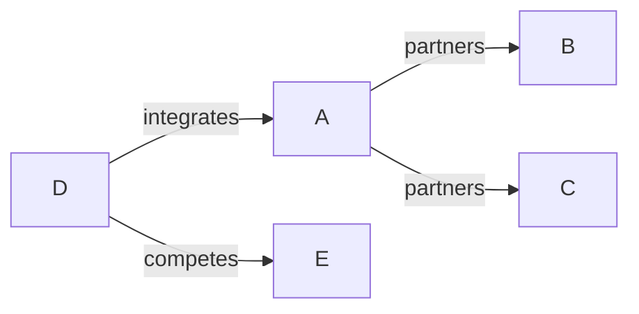

<!-- translated from upstream/references/blocks/map.md @ e233797 — see docs/TRANSLATION.md -->
# MAP blocks — cartography

Blocks for the landscape genre and any research about the map of a field, its players, its connections.

---

## M1 — `categories`

**When:** Landscape. Dividing the field into categories before enumerating the players.

**What's inside:** Categories with definitions and the number of players.

**Anti-pattern:** Too many categories (>6) — the value is lost. Overlapping categories — impossible to classify.

**Composition:** After `scope`. Before `profile-card`.

**Template:**

```markdown
## Categories

### Category A: <name>
**Definition:** <what belongs here, by which criteria>
**Players:** N
**Leaders:** P1, P2

### Category B: <name>
**Definition:** ...
**Players:** M
**Leaders:** ...

### Category C: borderline / new
**What it is:** players that do not fit A/B cleanly

**Classification principle:** <what we divide by — business model / technology / target audience>
```

---

## M2 — `profile-card`

**When:** Landscape (1 per player). Competitor analysis.

**What's inside:** A structured player card: origin, scale, niche, strengths/weaknesses, link.

**Anti-pattern:** A different template for different players — incomparable. One template for everyone in a landscape.

**Composition:** After `categories`. One card per player, grouped by category.

**Template:**

```markdown
## Player profiles

### Category A

#### P1: <name>
- **Origin:** founded YYYY, <country>
- **Funding / scale:** $XM <round>, ~N employees, ARR ~$Y
- **What it does:** <one sentence>
- **Niche / unique:** <what sets it apart>
- **Strengths:** ... [s03]
- **Weaknesses / critique:** ... [s07]
- **Tech / approach:** <stack or key approach>
- **Customers / users:** <ICP, known cases>
- **Links:** [website](url) · [docs](url) · [blog](url)
- **Status:** active | growing | declining | acquired by X (date)

#### P2: <name>
(same structure)

### Category B

#### P3: ...
```

---

## M3 — `positioning-map`

**When:** Landscape when there are 2 meaningful axes for positioning.

**What's inside:** A 2×2 ASCII map + justification of the axes.

**Anti-pattern:** Axes without justification — they look arbitrary. Each axis must be meaningful for the field.

**Composition:** After `profile-card`. Before `trends`.

**Template:**

```markdown
## Positioning map

Axes:
- **X axis: Niche ↔ Mainstream** — breadth of the target audience
- **Y axis: Low capability ↔ High capability** — depth of the product on its core feature

```
              High capability
                    │
       P1 ●         │         ● P3
                    │
                    │   ● P5
   Niche ───────────┼─────────── Mainstream
                    │
       P2 ●         │         ● P4
                    │
              Low capability
```

**Justification of placement:**
- P1 (high/niche): strong products, narrow audience [s03]
- P3 (high/mainstream): leader on all fronts [s07]
- P2 (low/niche): a niche utility
- P4 (low/mainstream): bottom of market
- P5 (mid/mainstream): emerging

**Movement (over the past year):**
- P5 is moving toward high-cap
- P2 is stagnating
```

---

## M4 — `trends`

**When:** Landscape, market analysis. What happens over time.

**What's inside:** What is growing / dying / appearing / consolidation vs fragmentation.

**Anti-pattern:** Trends based on vibes. Every trend is a concrete observable signal or a number.

**Composition:** After `positioning-map`. Before `white-spaces`.

**Template:**

```markdown
## Trends

### What is growing
- **<trend>** — signal: <concrete observation>, source [s03]
- **<trend>** — ...

### What is dying
- **<trend>** — signal: ..., [s07]
- ...

### What is emerging
- **<trend>** — signal: <marker of emergence>, [s11]
- ...

### Consolidation vs fragmentation
- **Consolidation:** N acquisitions over the past year — who bought whom
- **New entrants:** M new companies — where
- **Direction:** consolidation / fragmentation / neutral

### What is NOT moving (despite expectations)
- <thing> — we expected it to grow, it is not growing. Why: ...
```

---

## M5 — `white-spaces`

**When:** Landscape for product strategy. Where nobody is — the opportunities.

**What's inside:** Empty niches with a justification of why they are empty.

**Anti-pattern:** A white space without an explanation of why it is empty — it may be "nobody needs it" rather than an opportunity.

**Composition:** After `trends`. Follows logically from the map.

**Template:**

```markdown
## White spaces

### WS1: <niche>
**Where nobody is:** <description of the niche>
**Why it is empty (our hypotheses):**
- A: the market is small → no opportunity
- B: technically hard → opportunity for those who solve it
- C: nobody has tried → opportunity for a first mover
**Most likely reason:** <one of A/B/C> [s05]

### WS2: <niche>
...

### Sanity check
Did we ask people in the industry whether the niche really is empty? If not — mark it "may be incomplete".
```

---

## M6 — `genealogy`

**When:** Custom for academic/tech fields. Who came out of where.

**What's inside:** Descent trees: companies out of companies, ideas out of ideas, forks.

**Anti-pattern:** A linear history without branches — an oversimplification. Real genealogy is always a tree.

**Composition:** A supplement to `categories` or `network-graph`. For a deep understanding of the field.

**Template:**

```markdown
## Genealogy

```
                ┌─────────────┐
                │ FoundationCo│ (2010)
                │  (parent)   │
                └──────┬──────┘
          ┌────────────┼─────────────┐
          ▼            ▼             ▼
     ┌────────┐   ┌────────┐    ┌────────┐
     │ Spin A │   │ Spin B │    │ Spin C │
     │ (2015) │   │ (2017) │    │ (2019) │
     └───┬────┘   └────────┘    └───┬────┘
         │                          │
    ┌────┴────┐                 ┌───┴────┐
    ▼         ▼                 ▼        ▼
  Fork A1  Fork A2          Sub C1   Sub C2
```

**People:**
- FoundationCo was founded by <X, Y, Z>. Many alumni are founders of today's players.
- Spin A — founded by <ex-FoundationCo> in 2015. See the card above.
- ...

**What this makes clear:** <e.g.: "the whole field grew out of 3 schools of thought">
```

---

## M7 — `ranked-list`

**When:** Custom for "top-N" questions. When ranking is needed.

**What's inside:** A ranked list with the ranking criteria and the justification.

**Anti-pattern:** Ranking without criteria — immediately arguable. Show the criteria transparently.

**Composition:** An alternative to `profile-card` for a landscape when ranking matters more than categorisation.

**Template:**

```markdown
## Top N

**Ranking criterion:** <what we rank by> (descending).

| Rank | Player | Score | Key reason | Source |
|---|---|---|---|---|
| 1 | A | 92 | <one sentence> | [s03] |
| 2 | B | 85 | <one sentence> | [s07] |
| 3 | C | 80 | <one sentence> | [s11] |
| 4 | D | 72 | <one sentence> | [s15] |
| 5 | E | 68 | <one sentence> | [s19] |

**What did NOT make it (close to making list):** F, G.

**Caveats:**
- The ranking depends on the criterion — with another criterion the order differs
- Confidence in the ranking: high for 1-2, medium for 3-5
```

---

## M8 — `value-chain`

**When:** Industry analysis. The value creation chain by link.

**What's inside:** The links of the chain + the players at each + where value is captured.

**Anti-pattern:** A chain of 2 links — almost always an oversimplification.

**Composition:** A supplement to `categories`. An alternative dimension for a landscape.

**Template:**

```markdown
## Value chain

```
[Sources of raw data] → [Aggregation] → [Processing/ML] → [APIs] → [Apps] → [End users]
       ↑                      ↑                ↑              ↑          ↑
   Players:                Players:         Players:       Players:   Players:
   - Origin1               - Aggr1          - ML1          - API1     - App1
   - Origin2               - Aggr2          - ML2          - API2     - App2
```

**At which link value is captured:**
- Sources of raw data: low margin, commoditized
- Aggregation: medium margin, network effects
- **Processing/ML: highest margin** ← where the money is
- APIs: medium margin, lock-in
- Apps: variable

**Vertical integration:**
- Who owns several links: <player X owns aggregation + processing + API>
- Pure-play at one link: <player Y, Z>
```

---

## M9 — `network-graph`

**When:** Relationships in field. Who is connected to whom.

**What's inside:** Mermaid `graph LR` — the primary form. ASCII or a relations table — the fallback when the document is not built.

**Anti-pattern:** A graph where the edges are not typed — a picture of "everyone with everyone". Every edge carries a type (`partners`/`competes`/`integrates`/`acquired`) and is spelled out in the legend under the diagram.

**Composition:** A supplement to `categories`. When the relations between players matter more than categorisation.

**Template:**

````markdown
## Network



**Edge types:**
- **partners:** formal partnership, there is a public announcement
- **competes:** a direct competitor on >50% of the product
- **integrates:** one uses the other as a dependency
- **acquired:** owned

**Key observations:**
- A — a central hub, partners with the majority
- D and E — former competitors, now integrates after pivot
- ...
````

**Rendering:** see E13 — the same pipeline `build_report.py` → `mmdc` → "Diagram N".

---

## M10 — `funding-tree`

**When:** Startup ecosystem. Investment ties.

**What's inside:** Who invested in whom, ownership chains, the latest rounds.

**Anti-pattern:** Sizes without dates only — funding goes stale fast.

**Composition:** A supplement to `profile-card` for a startup landscape.

**Template:**

```markdown
## Funding tree

### Investors (top)
- **VC A:** portfolio: P1, P3, P5. Total deployed: $50M.
- **VC B:** portfolio: P2, P4. Specializes in <stage/sector>.
- **Strategic Z:** invests only in <profile>, owns P6.

### Latest rounds
| Player | Round | Date | Amount | Lead investor | Valuation |
|---|---|---|---|---|---|
| P1 | Series B | 2025-09 | $30M | VC A | $200M |
| P3 | Seed | 2025-04 | $3M | VC C | $20M |
| P5 | Series A | 2024-11 | $12M | VC A | $60M |

### Ownership patterns
- VC A — the biggest player, ~30% of the industry in its portfolio
- Cross-holdings: VC A and VC B participated together in P5
- M&A pattern: <if any>

### Total capital in space
~$<X>M over the last 24 months. Trend: <acceleration / deceleration>.
```

---

## M11 — `geographic-distribution`

**When:** A geo-distributed topic (global market analysis).

**What's inside:** Where the players/events are located, plus geo differences.

**Anti-pattern:** A bare list of countries without an explanation of why it matters.

**Composition:** A supplement for a landscape with geographic differentiation.

**Template:**

```markdown
## Geographic distribution

### By region

| Region | N players | Top examples | Specific character |
|---|---|---|---|
| North America | 12 | A, B, C | enterprise-focused |
| EU | 7 | D, E, F | compliance-driven |
| Asia | 5 | G, H | mobile-first |
| Rest | 3 | I | emerging |

### Hot spots (where the density is)
- San Francisco Bay Area: 6 players
- London: 3 players
- Singapore: 2 players

### Regional specialization
- **NA:** enterprise integration, B2B
- **EU:** GDPR-native, data sovereignty
- **Asia:** consumer apps, mobile UX

### Cross-region patterns
- Multi-region: <who>
- Single-region only: <who>
- Expanding: <who, where to>
```

---

## M12 — `lifecycle-stage`

**When:** Industry maturity analysis. Where each player sits on the S-curve.

**What's inside:** Players distributed across the lifecycle stages.

**Anti-pattern:** Assuming everyone is at the same stage. In reality they differ.

**Composition:** An alternative dimension for a landscape. A supplement to `categories`.

**Template:**

```markdown
## Lifecycle stages

### Early / experimental (pre-product-market-fit)
- P5 — pilot users, no clear ICP yet
- P8 — recent launch, traction TBD
- P9 — still in beta

### Growth (PMF + scaling)
- P1 — 10x YoY, hiring rapidly
- P3 — Series B, expanding geo
- P7 — strong product, expanding to enterprise

### Mature (stable, generating profit)
- P2 — predictable revenue, stable team
- P6 — slow growth but profitable

### Decline / sunset
- P10 — losing customers, no recent updates
- P4 — acquired and absorbed (effectively sunset)

### Industry overall stage
- **Stage:** growth phase
- **Indicators:** N new entrants/year, M acquisitions, increasing total funding
- **Likely next:** consolidation in 18-24 months
```
